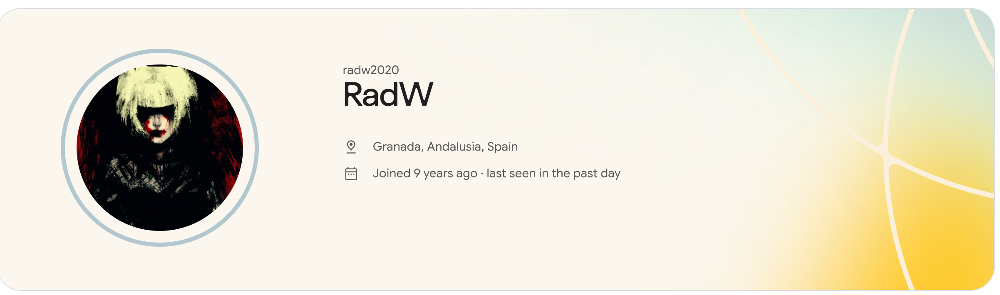
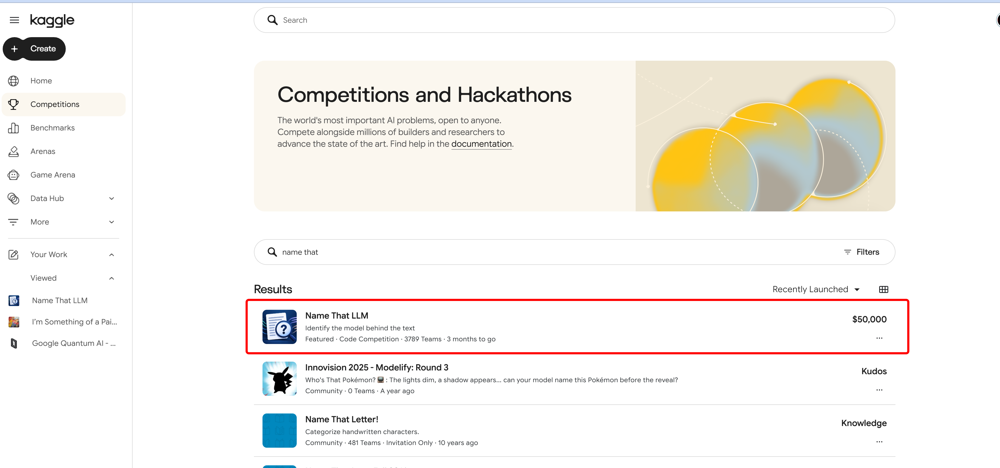
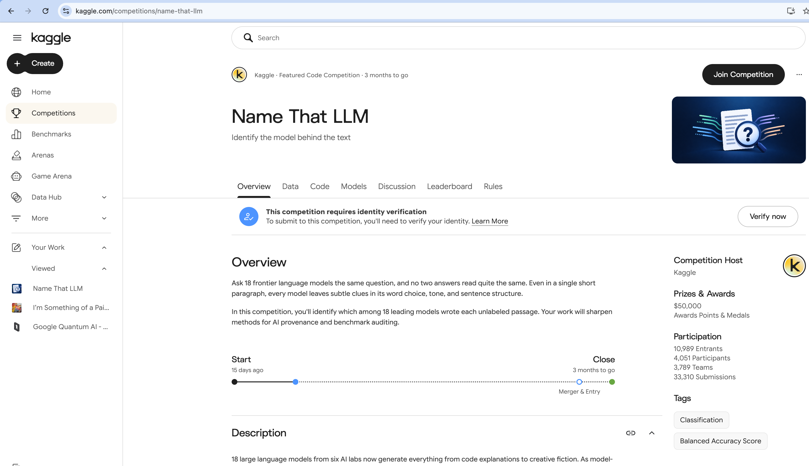
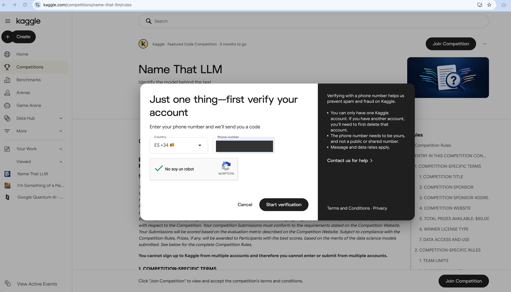
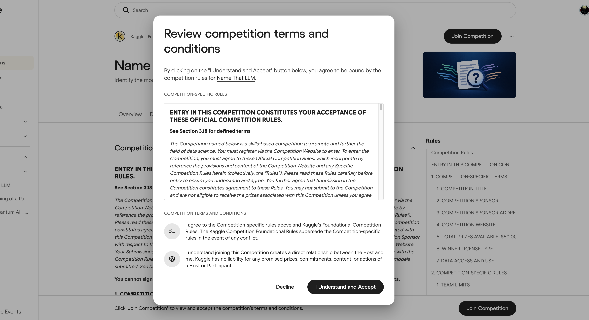
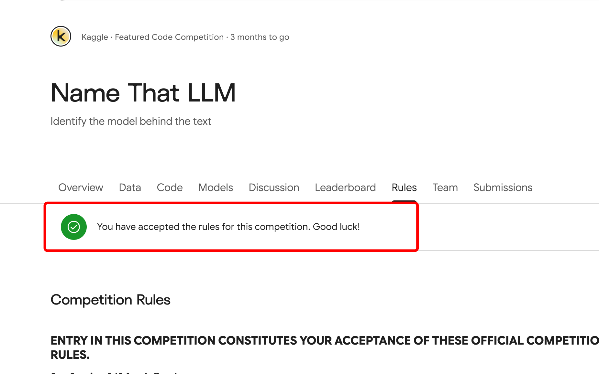
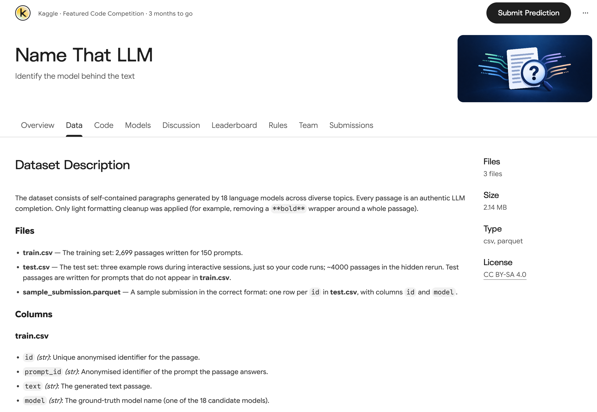
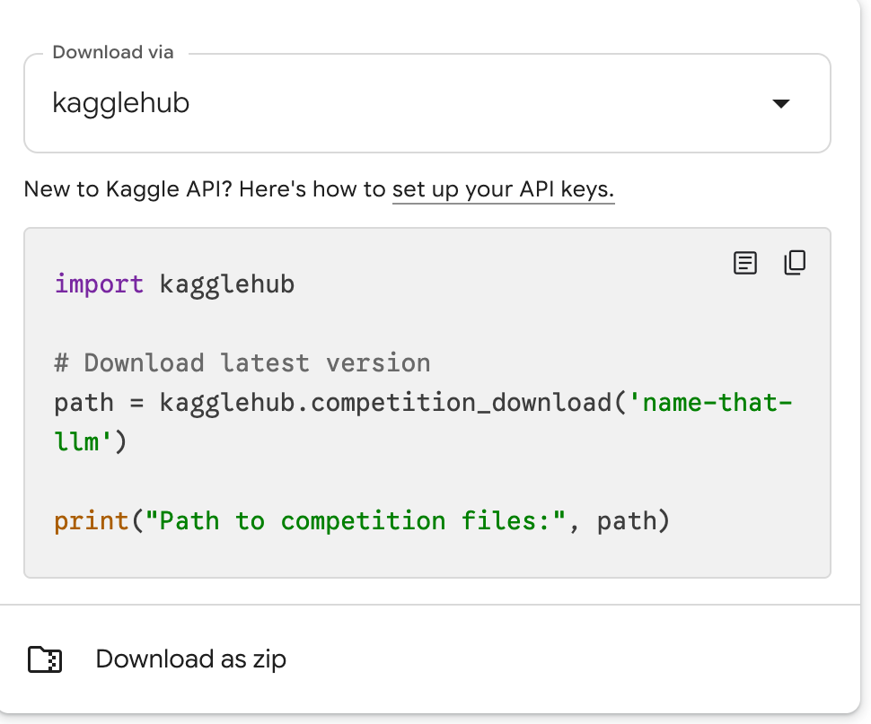
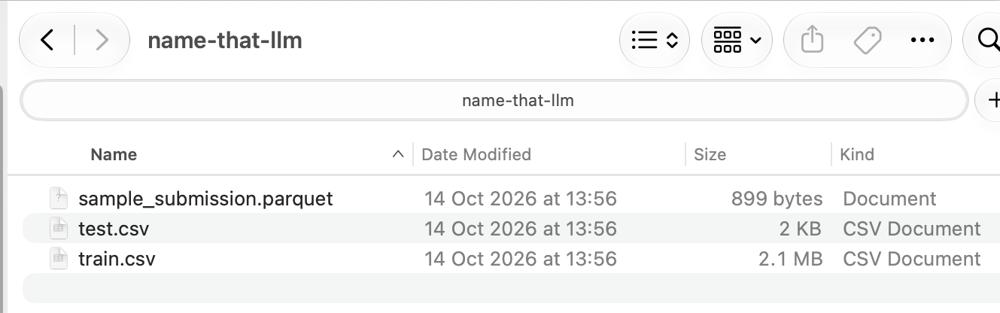
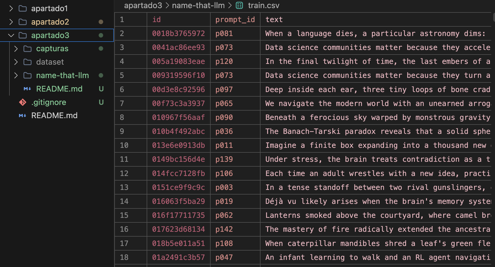

# Apartado 3 · Competición en Kaggle

Raúl Jiménez Martín

Competición elegida: **[Name That LLM](https://www.kaggle.com/competitions/name-that-llm)**

## 1. Cuenta de Kaggle

No he tenido que crear una cuenta nueva: ya tenía una desde hace más de 9 años, con el usuario `radw2020`. En el perfil se ve la antigüedad («Joined 9 years ago»).

## 2. Acceso a una competición activa

Desde la sección **Competitions** busqué la competición. Name That LLM es una *Featured Code Competition* con 50.000 $ en premios y le quedan 3 meses para cerrar, así que está activa.

En la página de la competición (pestaña **Overview**) se explica el reto: identificar cuál de 18 modelos de lenguaje ha escrito cada texto. Es un problema de clasificación que se evalúa con *balanced accuracy*. Arriba aparece un aviso de que la competición exige verificar la identidad.

Antes de poder unirme a la competición, Kaggle me pidió verificar mi identidad en dos pasos: primero un reconocimiento facial a través de Persona, el servicio de verificación que usa Kaggle, y después un código enviado por SMS a mi móvil. En la captura he tapado el número de teléfono.

Una vez verificado, al pulsar **Join Competition** aparecen las reglas, que hay que aceptar con **I Understand and Accept**. Sin este paso Kaggle no deja descargar los datos.

Con las reglas aceptadas aparece la confirmación y se habilitan las pestañas **Team** y **Submissions**.

## 3. Descarga del dataset

En la pestaña **Data** está la descripción del dataset: 3 ficheros (2,14 MB en total) con licencia CC BY-SA 4.0.

- `train.csv`: conjunto de entrenamiento, 2699 textos escritos para 150 *prompts*.
- `test.csv`: solo 3 filas de ejemplo; el test real (~4000 textos) está oculto y se ejecuta al enviar el código.
- `sample_submission.parquet`: ejemplo del formato de envío (`id`, `model`).

Kaggle ofrece descargar los datos con la librería `kagglehub` o como zip. Yo usé **Download as zip**.

## 4. Dataset descargado

Al descomprimir el zip quedan los tres ficheros:

Abrí `train.csv` en VS Code para ver su contenido. Cada fila es un texto generado por un modelo, con las columnas `id`, `prompt_id`, `text` y `model` (el modelo que lo escribió, que es lo que hay que predecir).

El conjunto de entrenamiento está equilibrado: 150 textos por cada uno de los 18 modelos (149 en uno de ellos), de unas 115 palabras de media. Los modelos son de Anthropic, Google, OpenAI, Qwen, Moonshot (Kimi) y Z.ai (GLM).

El dataset no se sube al repositorio (está en el `.gitignore`); aquí solo van las capturas.
